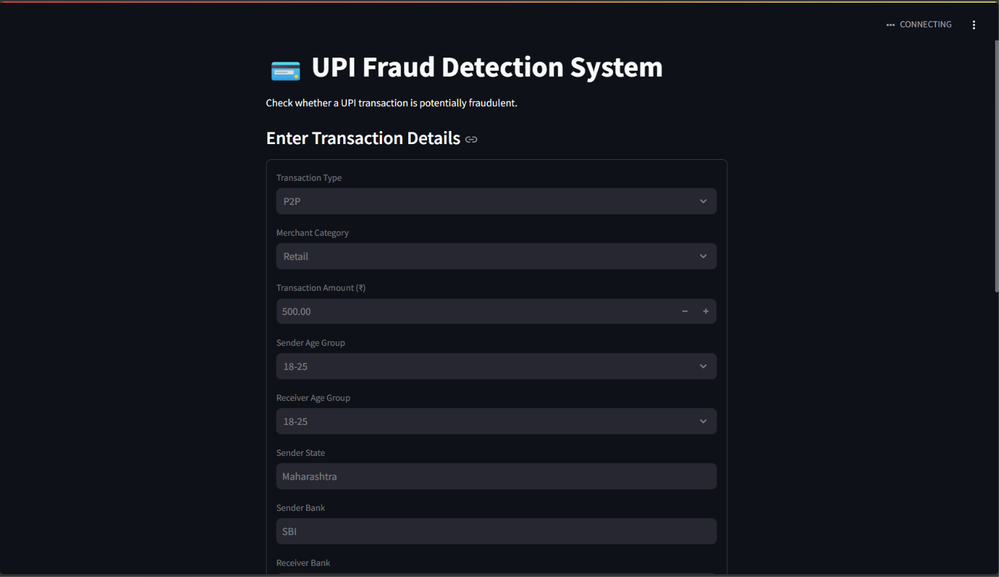
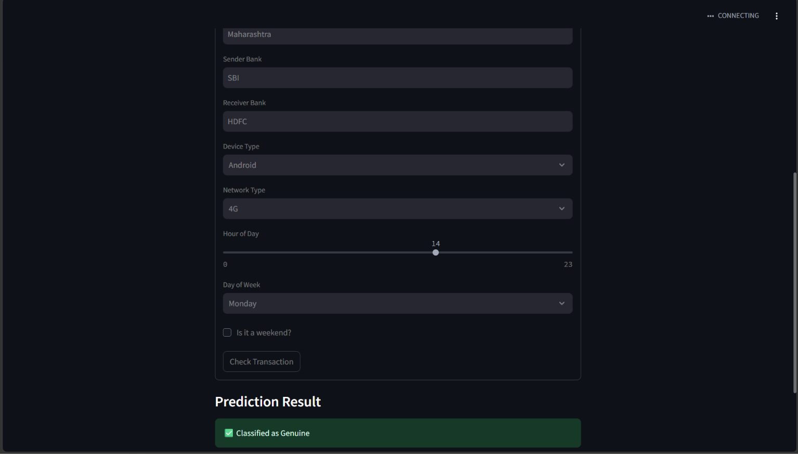
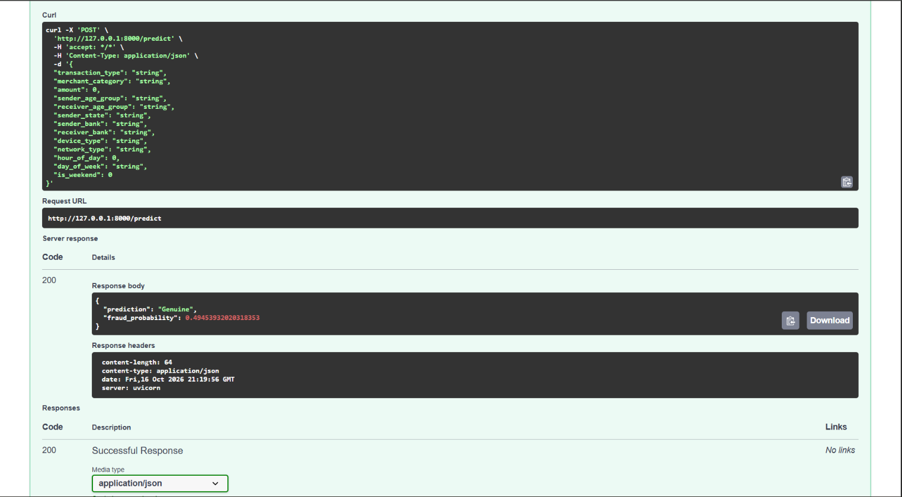

# 💳 UPI Fraud Detection System

An end-to-end machine learning project that explores the classification of potentially fraudulent UPI transactions using Python, scikit-learn, FastAPI, and Streamlit.

The project includes exploratory data analysis, multiple classification algorithms, a FastAPI prediction API, and a Streamlit interface for entering transaction details and viewing predictions.

## 📸 Project Screenshots

### 1. Streamlit Application

Enter transaction details through the interactive web interface.



### 2. Prediction Result

Example output from the application. This screenshot shows a transaction classified as genuine.



### 3. FastAPI Prediction API

The `/predict` endpoint accepts transaction data and returns a JSON response.



## ✨ Features

- Exploratory data analysis and preprocessing
- Transaction amount and transaction type analysis
- Sender and receiver attributes
- Merchant category and banking information
- Device, network, and time-based features
- Comparison of multiple classification algorithms
- Model evaluation using classification metrics
- FastAPI backend for transaction predictions
- Streamlit frontend for interactive transaction input
- JSON responses from the prediction API

## 🤖 Machine Learning

The notebook explores the following classification algorithms:

- Logistic Regression
- K-Nearest Neighbors (KNN)
- Naive Bayes
- Decision Tree
- Support Vector Machine (SVM)
- Random Forest

Model evaluation includes:

- Confusion matrix
- Precision
- Recall
- F1-score
- Accuracy

Fraud detection is a highly imbalanced classification problem. Therefore, accuracy alone is not sufficient to determine whether a model is useful for detecting fraud.

## 🛠️ Tech Stack

- **Language:** Python
- **Data analysis:** Pandas, NumPy
- **Visualization:** Matplotlib, Seaborn
- **Machine learning:** Scikit-learn
- **API:** FastAPI, Uvicorn
- **Frontend:** Streamlit
- **Development:** Jupyter Notebook, VS Code
- **Version control:** Git and GitHub

## 📂 Project Structure

```text
archive/
├── backend/
│   └── main.py
├── models/
│   ├── random_forest_candidate.pkl
│   └── preprocessor.pkl
├── notebooks/
│   └── UPI_Fraud_Detection.ipynb
├── screenshots/
│   ├── api-response.png
│   ├── streamlit-form.png
│   └── prediction-result.png
├── app.py
├── .gitignore
└── README.md
```

## 🚀 Getting Started

### Prerequisites

- Python 3.10 or a compatible Python version
- Git
- pip

### 1. Clone the repository

```bash
git clone https://github.com/AbhayRana123987/upi-fraud-detection.git
cd upi-fraud-detection
```

### 2. Create and activate a virtual environment

```bash
python -m venv .venv
```

**Windows PowerShell:**

```powershell
.\.venv\Scripts\Activate.ps1
```

### 3. Install dependencies

Install the libraries used by the application and notebook. If the repository contains a `requirements.txt`, run:

```bash
pip install -r requirements.txt
```

Otherwise, install the core application dependencies:

```bash
pip install fastapi uvicorn streamlit pandas numpy scikit-learn joblib
```

Additional libraries may be required to run the notebook, depending on the imports used.

### 4. Start the FastAPI backend

From the project root, run:

```bash
uvicorn backend.main:app --reload --port 8000
```

Open the interactive API documentation at:

http://127.0.0.1:8000/docs

### 5. Start the Streamlit frontend

Open a second terminal in the project root, activate the same virtual environment, and run:

```bash
python -m streamlit run app.py
```

Streamlit will display a local URL, typically:

http://localhost:8501

Keep the FastAPI backend running while using the frontend.

## 🔌 API Endpoint

**Endpoint:** `POST /predict`

The API accepts transaction features such as transaction type, amount, merchant category, sender and receiver information, device, network, and timing attributes.

The response includes a predicted transaction class and a fraud probability, as implemented by the backend.

Explore the endpoint and its required request fields through the FastAPI documentation at `/docs`.

## 📊 Dataset

The project uses a UPI transaction dataset containing transaction-level features, including:

- Transaction type and amount
- Merchant category
- Sender and receiver age groups
- Sender state
- Sender and receiver banks
- Device type and network type
- Hour of day and day of week
- Weekend indicator

The dataset is used for educational experimentation. The CSV is excluded